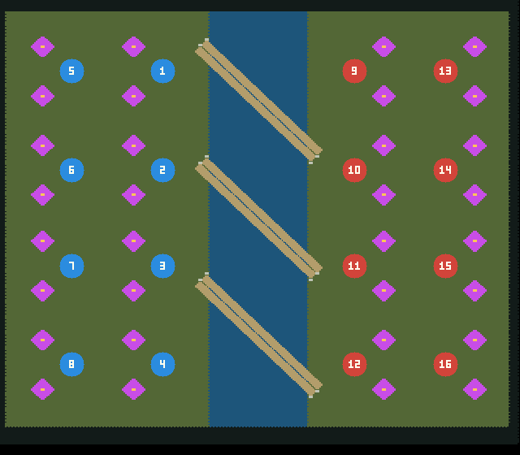

# Winlife 红警联机 · RA2WEB 扩展

面向局域网和公网联机的 RA2WEB / Chrono Divide 扩展源码，包括昵称大厅、联机服务、地图工坊和 16 人地图工具。

本仓库公开 Winlife 维护的服务端、客户端补丁脚本、网页工具和地图生成代码。**完整游戏引擎、EA 游戏素材、MOD 安装包和收集的第三方地图不在仓库内**。游戏客户端基于 [RA2WEB](https://github.com/ra2web/ra2web.github.io)；原游戏、引擎和素材的权利归各自权利人所有。许可范围见 [NOTICE.md](NOTICE.md)。

## 已有功能

- 设置昵称进入大厅，浏览器保存昵称。
- 房间内每位玩家的往返延迟、抖动和等待状态显示。
- 按 RTT 与抖动调整的两回合指令缓冲，网络轮次为 60–200 ms。
- 短暂掉线自动重试；同一浏览器刷新或重开页面后恢复未结束对局。
- 结算后返回原房间、对局期间锁房、空房间清理。
- 最多 16 名参战者与 1 名观察者，修正客机席位和房间布局。
- 真实 `.map` 编解码、地图编辑器、撤销重做、后台编码、中文名称与内容去重工具。
- 给其他 AI 使用的地图制作规范、生成脚本和验收工具源码。
- 原创 16 人平原与「两岸会战 8v8」：紫矿、持续产矿矿井、三组双桥和内嵌缩略图。
- 显卡诊断、经典键鼠界面和浏览器手势干扰防护。

联机采用**客户端确定性模拟与指令锁步**。本仓库的服务端负责大厅、指令转发、网络调参和恢复历史，不是服务器权威战斗模拟；持续掉包或客户端执行缓慢仍可能让对局等待。

## 本地启动联机服务

需要 Node.js 22 或以上、npm；Python 工具需要 Python 3.9 或以上。

```sh
git clone https://github.com/Winlifes/winlife-ra2web.git
cd winlife-ra2web
npm ci
npm test
ORIGIN=http://localhost:8080 npm start
```

服务默认监听 `127.0.0.1:18600`，健康检查为 `http://127.0.0.1:18600/healthz`。仅启动该服务不会显示完整游戏；网页客户端需要另行准备并通过同源反向代理连接服务。部署方法见 [docs/deployment.md](docs/deployment.md)。

## 生成两张原创地图

这一步不需要游戏客户端或游戏资源，也不需要模型 API。

```sh
npm run maps
# 使用新的输出目录再次生成
npm run maps -- --out artifacts/another-map-build
```

输出真实 `.map`、内嵌游戏缩略图、PNG 预览和 SHA-256 清单。已存在的输出目录会被拒绝覆盖。超过 8 人的地图需要本项目的扩展客户端；原生 8 人客户端不会因为地图声明而自动支持 16 人。

「两岸会战 8v8」使用左岸 1–8、右岸 9–16 号出生点，61 列中央河面、6 座桥、12 座维修小屋、32 座紫矿矿井。两队需要在房间自行选择对应位置和队伍。可直接下载 [原创地图示例](examples/maps/)。



## 目录

| 路径 | 内容 |
| --- | --- |
| `deploy/ra2web-lan/server/` | WOL/Gserv WebSocket 联机服务、网络策略与回归测试 |
| `deploy/ra2web-lan/*-client.py` | 绑定兼容客户端版本的补丁脚本 |
| `deploy/ra2web-lan/map-editor/` | 地图编码、编辑器、存储和 Worker |
| `deploy/ra2web-lan/map-library/` | 地图库、兼容扫描、去重、翻译和原创地图生成 |
| `deploy/ra2web-lan/map-ai/` | AI 地图制作包的源码与文档 |
| `deploy/ra2web-lan/{reconnect,graphics,input}/` | 浏览器辅助界面与相关测试 |
| `deploy/ra2web-public/` | 公网发布的构建与静态压缩工具 |
| `deploy/Caddyfile.example` | 可配置的同源反向代理示例 |
| `scripts/` | 源码检查、原创地图生成和开发入口 |

## 验证与限制

`npm test` 运行无需游戏资源的回归；`npm run check` 检查 JavaScript/Python 语法；`npm run maps` 检查原创地图的编解码、出生点、资源和桥梁数据。需要实际客户端、MIX 或地图样本的测试单独保留，见 [docs/testing.md](docs/testing.md)。

断线恢复依赖服务端内存；服务端重启后不能恢复旧对局。昵称不是账号身份认证。同一浏览器和同一站点下保存的恢复记录不会自动迁移到另一台电脑。

最新 8v8 地图的原生加载、静态两岸连通和三组双桥显示已检查；**车辆完整过桥与 16 台实体设备压力测试仍待验收**。地图数据预览不能代替实际游戏通行验证。

## 许可

本仓库维护代码以 **AGPL-3.0-or-later** 提供，见 [LICENSE](LICENSE)。第三方依赖、上游客户端、游戏素材及第三方地图保留各自条款。上游 README 另载个人研究、爱好使用及署名要求，原文保存在 [third_party/ra2web/](third_party/ra2web/)，不能把本仓库的许可扩展到这些第三方内容。
